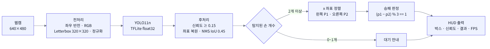

# CNN RPS Game: 실시간 가위바위보 대결

웹캠 영상에서 **두 사람의 손을 동시에 탐지**하고, 각 손이 가위·바위·보 중 무엇인지 분류해서 **실시간으로 승패를 판정**하는 게임입니다.
**YOLO11n** 객체 탐지 모델을 학습해 **TFLite(LiteRT)** 로 변환하고 `tflite_runtime`만으로 동작하도록 만들어, 가벼운 엣지 환경에서도 실행할 수 있습니다.

> 개인 프로젝트 (Solo Project, 2026.09)

## System Overview



## 주요 기능

- **손 탐지 + 제스처 분류**: 한 번의 추론으로 손 위치(바운딩 박스)와 클래스(`SCISSORS` / `ROCK` / `PAPER`)를 함께 출력
- **2인 대결**: 화면의 왼쪽 손을 Player 1, 오른쪽 손을 Player 2로 자동 지정
- **실시간 판정**: `DRAW!` / `PLAYER 1 WIN!` / `PLAYER 2 WIN!`
- **HUD 스타일 UI**: 플레이어별 색상 바운딩 박스, 신뢰도(%) 배지, 상단 스코어보드, FPS 표시
- **상태 안내**: 손이 0개면 "Show 2 Hands", 1개면 "Waiting for second player"

## 동작 흐름

```
웹캠 프레임 (640x480, 좌우 반전)
   │
   ▼
전처리: BGR→RGB, Letterbox 320x320, 0~1 정규화 (INT8 모델이면 양자화)
   │
   ▼
TFLite 추론 → [cx, cy, w, h, score_scissors, score_rock, score_paper] × N
   │
   ▼
후처리: 신뢰도 필터(0.15) → 원본 좌표 복원 → NMS(IoU 0.45)
   │
   ▼
x 좌표로 정렬 → P1(왼쪽) / P2(오른쪽) → 승패 판정 → HUD 출력
```

### 승패 판정
클래스를 `가위=0, 바위=1, 보=2`로 두면, 이기는 쪽은 항상 지는 쪽보다 1 크다는 규칙(순환)을 이용해 한 줄로 판정합니다.

```python
if p1 == p2:            return "DRAW!"
if (p1 - p2) % 3 == 1:  return "PLAYER 1 WIN!"   # 바위>가위, 보>바위, 가위>보
else:                   return "PLAYER 2 WIN!"
```

### 직접 구현한 전처리·후처리
라이브러리 의존을 줄이려고 YOLO 출력 디코딩, Letterbox 좌표 복원, NMS를 NumPy로 직접 구현했습니다.
코드 상단의 `modelPath`만 바꾸면 float32 / float16 / INT8 양자화 모델을 그대로 바꿔 끼울 수 있고, INT8 모델은 입력 양자화와 출력 역양자화를 자동으로 처리합니다.

## 실행 방법

```bash
pip install -r requirements.txt
python RPS_GAME.py
```

- 웹캠이 연결돼 있어야 합니다.
- `RPS_GAME.py`와 `best_float32.tflite`가 같은 폴더에 있어야 합니다.
- 종료: `Q`

## 파일 구성

| 파일 | 설명 |
|---|---|
| `RPS_GAME.py` | 추론, 후처리, 승패 판정, UI 전체 |
| `best_float32.tflite` | 학습된 YOLO11n 가위바위보 탐지 모델 (float32, 입력 320x320) |
| `requirements.txt` | 실행 패키지 |

## 개발 환경

Python, OpenCV, NumPy, TFLite Runtime (LiteRT), Ultralytics YOLO11n
